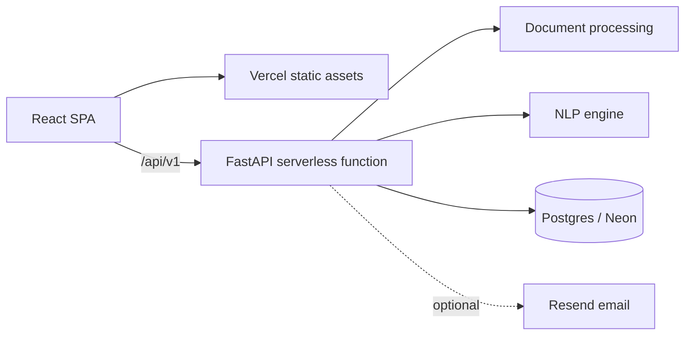

<div align="center">

# 🔍 CareerLens AI

### Resume Intelligence & ATS Optimization Platform


<br/>

A **full-stack resume analysis platform** that compares a resume against a specific job description and
explains exactly where it matches, where it only looks related, and what is missing.

**PDF + DOCX parsing** · **Hybrid keyword matching** · **Explainable 6-dimension score** · **Section-level feedback** · **Honest recommendations**

<br/>

### 🔗 Live demo: _add your URL here after deploying [https://careerlensai-iota.vercel.app/]_

</div>

---

# 🎯 Problem Statement

Job seekers rarely know why a resume fits one posting and not another. Keyword checkers are opaque, reward keyword stuffing, and often imply they reproduce an employer's ATS.

CareerLens AI is deliberately different:

<div align="center">

| Input | Output |
|---|---|
| A resume (PDF/DOCX) + a job description (pasted text or public URL) | Alignment score (0–100) with a visible formula, matched / related / missing keywords, per-section feedback, prioritized recommendations, and where each missing skill would fit |

</div>

> ⚠️ The score is a **heuristic alignment estimate**, never an employer ATS score, and the UI says so on every analysis.
> Recommendations are **suggestions**. CareerLens never invents skills, projects, or experience for you.

---

# ✨ Features

<table>
<tr>
<td width="50%">

### 🧠 Analysis Engine
- Structure-aware PDF/DOCX parsing (two-column handling, scanned-PDF detection)
- Section detection: summary, skills, experience, projects, education, certifications
- Skill taxonomy with aliases (`JS → JavaScript`, `Postgres → PostgreSQL`)
- Evidence levels: *demonstrated* vs *listed* vs *mentioned*
- Related skills (Flask ↔ Django) are labelled **not verified**
- Each requirement counted once, so keyword stuffing doesn't help

</td>

<td width="50%">

### 🖥️ Product
- Auth: Argon2, rotating refresh tokens, password reset
- Resume versions, manual section correction, preview
- Job import by URL (SSRF-guarded) with paste fallback
- Keyword explorer, skills comparison, section analysis
- History, side-by-side compare, score trend by resume version
- Light, responsive dashboard; privacy settings and full data deletion

</td>
</tr>
</table>

---

# 🏗️ Architecture

<div align="center">

```text
User uploads resume + adds job description
                 │
                 ▼
React Frontend (Vite + TypeScript)
Landing → Auth → Dashboard → Resumes → Jobs → Analysis workspace
                 │
                 ▼  /api/v1/*  (Bearer token + httpOnly refresh cookie)
FastAPI  (backend/app)
Routes → Services → Repositories      Auth · Rate limit · Audit log
                 │
        ┌────────┴─────────┐
        ▼                  ▼
Document processing     NLP engine
pdf_parser (PyMuPDF/    taxonomy → extractor → job_parser →
  pypdf fallback)       keyword_matcher → scorer →
docx_parser             recommendations → section_analysis
section_detector
resume_entities
        │                  │
        └────────┬─────────┘
                 ▼
SQLAlchemy 2 + Alembic
                 │
                 ▼
PostgreSQL (Neon)  ·  SQLite for local dev & tests
```

</div>



Layer rules: routes hold **no** business logic; services own transactions; repositories hold all queries (always scoped by `user_id`); `document_processing` and `nlp` are pure Python with no web or database imports, so they are independently testable. More in [docs/architecture.md](docs/architecture.md).

---

# 📂 Folder Structure

```bash
careerlens-ai/
├── frontend/
│   ├── src/
│   │   ├── pages/               # Landing, Login, Dashboard, Resumes, Jobs, AnalysisDetail, ...
│   │   ├── components/          # ui/ (Button, Card, Field, Tabs, ...) + analysis/ views
│   │   ├── layouts/             # AppLayout (sidebar), AuthLayout
│   │   ├── contexts/            # AuthContext, ToastContext
│   │   ├── services/            # axios client (token refresh) + typed API calls
│   │   ├── hooks/ · types/ · utils/ · styles/ (design tokens)
│   ├── e2e/                     # Playwright journey + synthetic fixtures
│   └── Dockerfile
│
├── backend/
│   ├── app/
│   │   ├── api/v1/              # auth, users, resumes, jobs, analysis, dashboard
│   │   ├── services/            # use-cases (auth, resume, job, analysis, dashboard)
│   │   ├── repositories/        # user-scoped DB queries
│   │   ├── models/ · schemas/   # SQLAlchemy models · Pydantic contracts
│   │   ├── document_processing/ # pdf_parser, docx_parser, section_detector, entities
│   │   ├── nlp/                 # taxonomy, matcher, scorer, recommendations, pipeline
│   │   ├── core/ · utils/       # config, security, SSRF guard, upload validation
│   ├── migrations/              # Alembic
│   ├── tests/                   # unit + API integration tests
│   └── Dockerfile
│
├── api/index.py                 # Vercel serverless entry (imports the FastAPI app)
├── infrastructure/              # nginx, scripts (smoke test, Windows setup)
├── .github/workflows/           # frontend-ci, backend-ci, e2e, docker-build, deploy
├── docs/                        # architecture, database, API, security, setup, deployment
├── docker-compose.yml · docker-compose.prod.yml
├── vercel.json · netlify.toml
├── requirements.txt             # production Python dependencies
└── .env.example
```

---

# 🚀 Quick Start

## 1️⃣ Backend (no database server needed)

```powershell
Copy-Item .env.example .env
cd backend
py -3.12 -m venv .venv
.\.venv\Scripts\Activate.ps1
pip install -r requirements-dev.txt
uvicorn app.main:app --reload --port 8000
```

API docs: `http://localhost:8000/api/docs`

## 2️⃣ Frontend

```powershell
cd frontend
npm install
npm run dev
```

Open: `http://localhost:5173` (Vite proxies `/api` to the backend)

## 3️⃣ Docker (full stack with Postgres)

```bash
docker compose up --build
```

Open: `http://localhost:8080` (nginx serves the frontend and proxies the API)

## 4️⃣ Free online hosting

Frontend + API on **Vercel (Hobby)** with a **Neon (free)** Postgres database. Free-tier limits change, so check [Vercel's limits](https://vercel.com/docs/functions/limitations) and [Neon's plan limits](https://neon.com/pricing) before relying on them. Full steps in [docs/deployment-guide.md](docs/deployment-guide.md):

1. Create a Neon project and copy the **pooled** connection string.
2. Create the tables once: `cd backend; $env:DATABASE_URL="<neon url>"; alembic upgrade head`
3. Push the repo to GitHub, import it into Vercel.
4. Set `APP_ENV=production`, `DATABASE_URL`, `JWT_SECRET` (32+ random chars), `APP_BASE_URL`, `MAX_UPLOAD_MB=4`.
5. Deploy, then open `/api/health/ready` and confirm `"database":"ok"`.

---

# 📡 API Reference

All endpoints are under `/api/v1`. Errors always look like `{"error": {"code", "message", "details"}}`. Full contract: [docs/api-documentation.md](docs/api-documentation.md).

### `POST /analysis`

**Request:**
```json
{ "resume_id": "uuid", "job_id": "uuid", "scoring_weights": { "required_skills": 40 } }
```

**Response (abridged):**
```json
{
  "id": "uuid",
  "overall_score": 48.4,
  "disclaimer": "This is a heuristic alignment score. It is NOT the score of any employer's ATS.",
  "dimension_scores": {
    "required_skills": { "score": 60, "weight": 35, "effective_weight": 35, "contribution": 21.0 }
  },
  "keyword_counts": { "exact": 4, "semantic": 1, "missing_mandatory": 2 },
  "skills_comparison": [ { "keyword": "Docker", "status": "missing", "importance": "required" } ],
  "section_analysis": [ { "section_type": "projects", "priority": "high" } ]
}
```

<div align="center">

| Endpoint | Description |
|---|---|
| `POST /auth/register` · `/login` · `/refresh` · `/logout` | Sessions with rotating refresh tokens |
| `POST /auth/forgot-password` · `/reset-password` | Password reset (always answers 202) |
| `POST /resumes/upload` | PDF/DOCX upload; parsing is synchronous |
| `GET /resumes` · `/resumes/{id}` · `/resumes/{id}/versions` | List, detail, version chain |
| `PATCH /resumes/{id}/sections/{section_id}` | Correct a section; skills are recomputed |
| `POST /resumes/{id}/reprocess` | Re-parse the stored original |
| `POST /jobs` · `/jobs/import-url` | Create from text or a public URL (SSRF-guarded) |
| `GET /analysis` | History with `company`, `job_title` filters |
| `GET /analysis/{id}/keywords` | Filterable, searchable, paginated keyword matches |
| `GET /analysis/{id}/recommendations` | Prioritized suggestions |
| `GET /analysis/compare?a=&b=` · `/analysis/trend?job_id=` | Compare runs, score by resume version |
| `GET /dashboard/summary` · `/recent-activity` | Real aggregates, no hardcoded numbers |
| `GET /api/health` · `/api/health/ready` | Liveness and database readiness |

</div>

---

# 🧠 NLP Pipeline Details

## Matching tiers

<div align="center">

| Tier | How it works | Credit |
|---|---|---|
| Exact / alias | Canonical name or alias found in the resume | By evidence level |
| Implied | e.g. Docker ⇒ Containerization | 0.8 × |
| Fuzzy | RapidFuzz ≥ 90, never across two known skills | ≤ 0.8 |
| Related (semantic) | Same skill family (Flask ↔ Django), **not verified** | ≤ 0.4 |
| Responsibilities | TF-IDF cosine similarity against resume bullets | Proportional |

</div>

**Evidence levels:** *demonstrated* (used in a described project or role) = 1.0 · *listed* (in a skills list) = 0.7 · *mentioned* = 0.35.

## Scoring dimensions

<div align="center">

| Dimension | Default weight |
|---|---|
| Required skills | 35% |
| Preferred skills | 15% |
| Experience | 20% |
| Responsibilities | 15% |
| Education & certifications | 10% |
| Structure & readability | 5% |

</div>

Weights are configurable per analysis. Dimensions that do not apply to a job (e.g. no education requirement) are dropped and their weight is redistributed, and the response shows each dimension's effective weight and contribution so the final number can be audited. These defaults are our own starting point, not an industry standard.

## Resume parsing

1. PyMuPDF extracts positioned text blocks (fallback: pypdf); a shared ordering step handles two-column layouts.
2. DOCX is read with python-docx (styles and tables).
3. PDFs with almost no text are flagged as scanned; OCR is an optional path (`OCR_ENABLED`, needs Tesseract).
4. Every upload gets an extraction confidence and a list of warnings.
5. Section detection uses a heading dictionary plus layout heuristics. Mistakes can be corrected in the UI.

---

# 🔒 Security & Privacy

<div align="center">

| Area | Implementation |
|---|---|
| Passwords | Argon2id, never logged |
| Sessions | 15-min access token held in memory; 7-day rotating refresh token in an httpOnly cookie; reuse detection revokes the token family |
| Authorization | Every query scoped by `user_id`; another user's ID returns 404 |
| Uploads | Extension + magic-byte checks, 4 MB limit, zip-bomb guard, sanitized names, no public file URLs |
| URL import | http/https only, ports 80/443, every resolved IP must be public, manual redirect re-validation, size and time limits |
| Rate limiting | Database-backed: logins, registrations, password resets |
| Headers | CSP, HSTS, X-Content-Type-Options, frame-ancestors none |
| Data control | Delete a resume, an analysis, all data, or the account |

</div>

See [docs/security.md](docs/security.md) for details and known limits.

---

# 🧪 Testing & CI/CD

<div align="center">

| Check | Command | Workflow |
|---|---|---|
| Backend lint & format | `ruff check . && ruff format --check .` | `backend-ci.yml` |
| Backend tests + coverage (Postgres) | `pytest --cov=app` | `backend-ci.yml` |
| Migrations on empty Postgres | `alembic upgrade head` | `backend-ci.yml` |
| Frontend | `npm run lint && npm run typecheck && npm test && npm run build` | `frontend-ci.yml` |
| End-to-end user journey | `npm run e2e` | `e2e.yml` |
| Image build, Trivy scan, publish to GHCR | | `docker-build.yml` |
| Staging / production deploy + smoke test | | `deploy.yml` |

</div>

Tests use **synthetic** resumes and job descriptions only. The Playwright journey covers: register → login → upload → add job → analyze → review keywords → recommendations → history → delete.

---

# ⚙️ Configuration

Copy `.env.example` to `.env`. Key variables:

```bash
APP_ENV=development          # production enforces strict checks
DATABASE_URL=sqlite:///./careerlens.db   # or a Postgres URL
JWT_SECRET=<32+ random chars>
APP_BASE_URL=http://localhost:5173
MAX_UPLOAD_MB=4
RESEND_API_KEY=              # optional, enables password-reset emails
OCR_ENABLED=false            # optional, needs Tesseract
```

---

# 🛠️ Design Decisions & Deviations

<div align="center">

| Original idea | What is implemented | Why |
|---|---|---|
| spaCy + Sentence Transformers | Taxonomy rules + pure-Python TF-IDF behind a `SemanticMatcher` interface | Those packages exceed Vercel's function size limit; swap-in path in `backend/requirements-ml.txt` |
| Redis rate limiting | Database-backed limits | No Redis on free serverless hosting |
| Background jobs | Synchronous parse + analysis | Serverless functions stop after the response |
| File storage on disk/S3 | Original file stored in Postgres, served only through an authorized endpoint | Serverless disk is ephemeral |

</div>

---

# 🎯 Platform Capabilities

<div align="center">

| Capability | Status |
|---|---|
| PDF & DOCX parsing with section detection | ✅ |
| Job description by paste or URL | ✅ |
| Exact / alias / implied / fuzzy / related matching | ✅ |
| Explainable weighted score with custom weights | ✅ |
| Recommendations & keyword placement | ✅ |
| History, compare, version trend | ✅ |
| Auth, privacy settings, account deletion | ✅ |
| Docker, GitHub Actions, Vercel config | ✅ (see verification note) |
| OCR for scanned PDFs on serverless hosting | 🚧 Optional on container hosts only |
| Neural embedding matcher | 🚧 Planned (container hosts) |
| Scheduled retention purge | 🚧 Planned |
| Exportable PDF reports | 🚧 Planned |
| OAuth sign-in | 🚧 Planned |

</div>

---

# ⚠️ Known Limitations

- Heuristic scoring: no machine-learned model and no employer-specific ATS behaviour.
- Skills outside the built-in taxonomy are not recognised (extend `backend/app/nlp/taxonomy_data.py`).
- Uploads are limited to 4 MB; scanned PDFs are detected and reported but not read on Vercel.
- `retention_days` is stored as a preference; automatic purge is not implemented yet.
- Password-reset emails need a Resend API key.

---

# ✅ Verification Status

During development, the document-processing and NLP engine tests, Ruff, and syntax checks of the frontend were executed. The FastAPI routes, SQLAlchemy layer, API tests, frontend type-check/tests/e2e, Docker builds and GitHub workflows were written but should be confirmed on your machine with the commands above. Update this section once your CI is green.

---

# 🔮 Roadmap

- [ ] Neural embedding matcher (Sentence Transformers) on container hosts
- [ ] Scheduled retention purge
- [ ] Background workers for large files
- [ ] Exportable PDF analysis reports
- [ ] Richer resume-version diffs
- [ ] OAuth sign-in
- [ ] Industry-specific taxonomy packs

---

# 🧰 Tech Stack

<div align="center">

| Layer | Technology |
|---|---|
| Frontend | React 18, TypeScript, Vite, Tailwind, Radix, Framer Motion, TanStack Query, React Hook Form, Zod, Recharts |
| Backend | FastAPI, Pydantic v2, SQLAlchemy 2, Alembic, PyJWT, Argon2 |
| Documents | PyMuPDF, pypdf, python-docx |
| NLP | Custom taxonomy engine, RapidFuzz, TF-IDF |
| Database | PostgreSQL (Neon), SQLite for local/tests |
| Testing | Pytest, Vitest, Testing Library, Playwright |
| Quality | Ruff, ESLint, Prettier |
| DevOps | Docker, nginx, GitHub Actions, Trivy, Vercel |

</div>

---

# ⚠️ Disclaimer

CareerLens AI provides heuristic guidance for educational and self-improvement purposes. It is not affiliated with any employer or ATS vendor, and a high score does not guarantee interviews or hiring outcomes.

---

<div align="center">

### ⭐ If you find this project useful, consider giving it a star!

Built with ❤️ using Python, FastAPI & React

</div>
