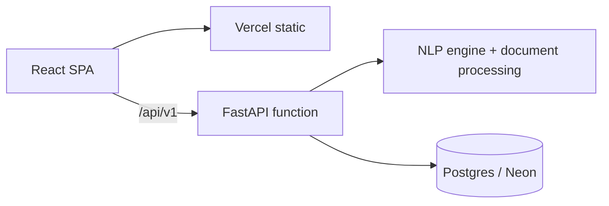

# CareerLens AI — Resume Intelligence & ATS Optimization Platform

CareerLens AI shows how well a resume aligns with a specific job description: matched, related and missing keywords, section-by-section feedback, and an **explainable, configurable alignment score**.

> The score is a heuristic estimate for your own guidance. It is **never** an employer ATS score, and every analysis says so. Recommendations are suggestions: CareerLens never invents skills, projects or experience.

## Features

- Register / login with Argon2 hashing, rotating refresh tokens, password reset
- PDF and DOCX upload with section detection, extraction confidence, scanned-PDF detection, manual section correction, version history
- Job descriptions by paste or public URL (SSRF-guarded, with paste fallback)
- Requirement extraction (required / preferred / responsibilities / experience / education / certifications)
- Hybrid matching: exact + alias, implied, fuzzy, related-skill (explicitly *not verified*), TF-IDF for responsibilities
- Six-dimension weighted score with visible formula, per-analysis custom weights, no keyword-stuffing inflation
- Keyword explorer (filter/search), skills comparison, section analysis, prioritized recommendations, keyword-placement suggestions
- Analysis history, side-by-side comparison, score trend across resume versions
- Dashboard from real data; settings with privacy, data deletion and account deletion

## Architecture



Details: [docs/architecture.md](docs/architecture.md) · [database schema](docs/database-schema.md) · [API contract](docs/api-documentation.md) · [security](docs/security.md)

## Stack

React 18, TypeScript, Vite, Tailwind, Radix primitives (shadcn-style components), Framer Motion, React Router, TanStack Query, React Hook Form, Zod, Recharts, Axios · FastAPI, Pydantic v2, SQLAlchemy 2, Alembic, PostgreSQL, Argon2, PyJWT · PyMuPDF / pypdf, python-docx, RapidFuzz · Docker, GitHub Actions, Pytest, Vitest, Playwright, Ruff, ESLint, Prettier.

## Quick start (Windows + VS Code)

```powershell
Copy-Item .env.example .env
cd backend; py -3.12 -m venv .venv; .\.venv\Scripts\Activate.ps1; pip install -r requirements-dev.txt
uvicorn app.main:app --reload --port 8000      # terminal 1 (SQLite by default)
cd ..\frontend; npm install; npm run format; npm run dev   # terminal 2 (format once so CI's format:check passes) → http://localhost:5173
```

Full instructions: [docs/setup-guide.md](docs/setup-guide.md).

## Deploy to Vercel

Import the repo into Vercel, create a Neon database, run `alembic upgrade head` once, set `APP_ENV`, `DATABASE_URL`, `JWT_SECRET`, `APP_BASE_URL`, and deploy. Step by step, plus Netlify, Docker and rollback: [docs/deployment-guide.md](docs/deployment-guide.md).

## Testing and CI

| Check | Command | Where |
|---|---|---|
| Backend lint/format | `ruff check . && ruff format --check .` | `backend-ci.yml` |
| Backend tests + coverage (Postgres) | `pytest --cov=app` | `backend-ci.yml` |
| Migrations | `alembic upgrade head` on empty Postgres | `backend-ci.yml` |
| Frontend | `npm run lint && npm run typecheck && npm test && npm run build` | `frontend-ci.yml` |
| End-to-end journey | `npm run e2e` | `e2e.yml` |
| Images + vulnerability scan + publish to GHCR | | `docker-build.yml` (runs after CI passes) |
| Staging / production deploy + smoke test | | `deploy.yml` |

Tests use synthetic resumes and job descriptions only.

## Screenshots

Add screenshots of the dashboard and analysis workspace here after your first run (`docs/screenshots/`).

## Known limitations

- Heuristic scoring: no machine-learned model, no employer-specific ATS behaviour.
- Semantic matching is taxonomy + TF-IDF, not neural embeddings (Vercel's size limit). The `SemanticMatcher` interface allows swapping in Sentence Transformers on a container host (`backend/requirements-ml.txt`).
- OCR for scanned PDFs is optional and needs Tesseract (Docker build arg `INSTALL_OCR=true`); on Vercel scanned PDFs are detected and reported, not read.
- Parsing and analysis run synchronously; uploads are limited to 4 MB.
- Retention days is stored as a preference; automatic purge is not implemented.
- Password-reset emails require a Resend API key.
- Optional LLM provider setting is reserved; nothing uses it yet.
- Skills outside the built-in taxonomy are not recognised (extend `backend/app/nlp/taxonomy_data.py`).

## Roadmap

Neural embedding matcher on container hosts · scheduled retention purge · background workers · exportable PDF reports · richer resume-version diffs · OAuth sign-in · expand the taxonomy per industry.

## Verification status of this delivery

What was executed during development: the document-processing and NLP engine tests, Ruff, and syntax checks of all frontend files. **Not executed in the authoring environment** (no package installs/network): the FastAPI routes and SQLAlchemy layer, the backend API tests (`tests/test_api_*.py`), `npm install`/typecheck/Vitest/Playwright, Docker builds and the GitHub workflows. Run the commands above once; expect to fix small integration issues. Production deployment requires your own Vercel and Neon accounts.
