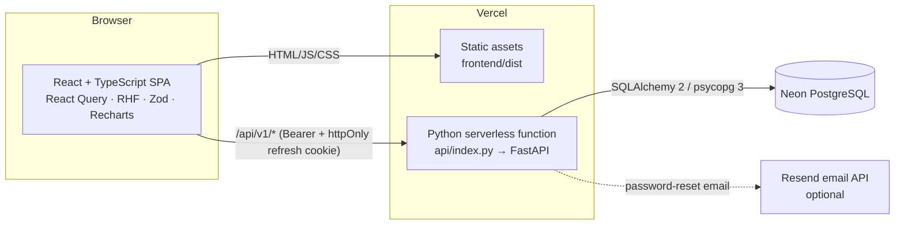

# Architecture

CareerLens AI is a single-repo SaaS: a React single-page app and a FastAPI backend that share one origin.

## Backend layers

| Layer | Location | Responsibility |
|---|---|---|
| API routes | `backend/app/api/v1/*` | HTTP only: parse input, call a service, shape output. No business logic. |
| Services | `backend/app/services/*` | Use-cases: auth, resume processing, job import, analysis orchestration, dashboard. Own the transaction boundaries and audit logging. |
| Repositories | `backend/app/repositories/*` | All SQLAlchemy queries. Every query is scoped by `user_id`. |
| Models | `backend/app/models/*` | SQLAlchemy 2.0 declarative models. |
| Schemas | `backend/app/schemas/*` | Pydantic request/response contracts (mirrored in `frontend/src/types/api.ts`). |
| Document processing | `backend/app/document_processing/*` | PDF/DOCX → blocks → sections → entities. Pure Python, no web or DB imports. |
| NLP engine | `backend/app/nlp/*` | Taxonomy, extraction, matching, scoring, recommendations. Pure Python, no web or DB imports. |
| Core | `backend/app/core/*` | Settings, DB engine, security primitives, error handling. |

The two pure layers (`document_processing`, `nlp`) are independently testable and can be reused by a worker or CLI.

## Request flow: running an analysis

1. `POST /api/v1/analysis {resume_id, job_id}` → route validates the body and the bearer token.
2. `analysis_service` loads the resume and job through user-scoped repositories (a foreign id yields `404`, never `403`, so ids can't be probed).
3. `nlp.pipeline.run_analysis(profile, requirements, …)` produces the match list, dimension scores, section analysis and recommendations.
4. Results are persisted in one transaction (`analyses`, `keyword_matches`, `recommendations`) and an audit row is written.
5. The route returns the full `AnalysisDetail`.

Analysis is synchronous (typically well under a second for pure-Python matching), which suits serverless hosting. The `SemanticMatcher` interface lets an embedding-based matcher replace the TF-IDF one on a container host without touching callers.

## NLP methodology

1. **Resume parsing.** PyMuPDF (fallback pypdf) extracts positioned text blocks; a shared ordering step handles two-column layouts. DOCX is read with python-docx (paragraph styles, tables). Scanned PDFs (< 80 characters/page) are detected and reported; OCR is an optional path (`OCR_ENABLED`, needs Tesseract). Every upload gets an *extraction confidence* and a list of warnings.
2. **Section detection.** Heading dictionary (many synonyms per section) plus typography/shape heuristics; unknown headings become `other`. Users can correct a section's type/content and skills are recomputed.
3. **Taxonomy and normalisation.** `nlp/taxonomy_data.py` is a table of `Canonical | category | aliases | family | implies`. `JS → JavaScript`, `Postgres/PostgreSQL → PostgreSQL`, `CI/CD → CI/CD`, `RESTful API → REST API`. Case-sensitive entries (`!`) prevent false hits such as the word "go" or "C". Distinct technologies are never merged.
4. **Job parsing.** Splits the posting into sections (requirements, nice-to-have, responsibilities…), extracts skills, years of experience, degrees and certifications, and classifies importance from the heading and phrasing ("must have", "nice to have", "preferred") with the evidence snippet kept.
5. **Matching** (hybrid, strongest evidence wins, each requirement counted once):

   | Tier | How | Credit |
   |---|---|---|
   | Exact / alias | canonical name or alias present | by evidence level |
   | Implied | e.g. Docker ⇒ Containerization | 0.8 × |
   | Fuzzy | RapidFuzz ≥ 90, never across two known skills | ≤ 0.8 |
   | Related (semantic) | same skill family (Flask ↔ Django) | ≤ 0.4, labelled *not verified* |
   | Responsibilities | TF-IDF cosine against resume bullets | proportional |

   **Evidence levels** control credit: *demonstrated* (used in a described project/role) 1.0, *listed* (skills list) 0.7, *mentioned* 0.35. Repeating a keyword never raises the score.
6. **Scoring.** Weighted average of six dimensions (defaults 35/15/20/15/10/5, user-configurable per analysis). Dimensions that don't apply to a job (e.g. no education requirement) are dropped and their weight redistributed; the response shows the effective weight and each dimension's contribution so the number can be audited.
7. **Recommendations.** Built from missing keywords, importance, existing evidence and best-fit section. Every item has `is_suggestion: true`, a caveat ("only add this if true") and, where useful, a template with `[bracketed]` placeholders. The engine never writes facts about the candidate.

The score is a **heuristic alignment score**, never an employer ATS score; the disclaimer is part of every analysis payload and the UI always renders it.

## Frontend

Vite + React 18 + TypeScript (strict). Routing with React Router (lazy-loaded pages). Server state with TanStack Query; forms with React Hook Form + Zod; charts with Recharts; styling with Tailwind using design tokens defined as CSS variables in `src/styles/globals.css` (palette from the brief). The access token is held in memory only; the 7-day refresh token is an httpOnly cookie, rotated on every use, and the client coalesces concurrent 401s into one refresh call.

## Deliberate deviations from the brief

| Brief | Implemented | Why |
|---|---|---|
| spaCy + Sentence Transformers | Rule/taxonomy engine + pure-Python TF-IDF behind a `SemanticMatcher` interface | Those packages exceed Vercel's 250 MB function limit. `backend/requirements-ml.txt` lists them for container hosts. |
| Redis rate limiting | DB-backed limits (login failures, registrations, password resets) | No Redis on Vercel. |
| Background processing | Synchronous parsing/analysis | Serverless functions end when the response is sent. |
| Private file storage on disk/S3 | Original files in a Postgres table, only served through an authorised endpoint | Serverless disks are ephemeral. Honors the "store original file" privacy setting. |
| Controllers layer | Routes call services directly | A separate controller layer adds indirection without value here. |
