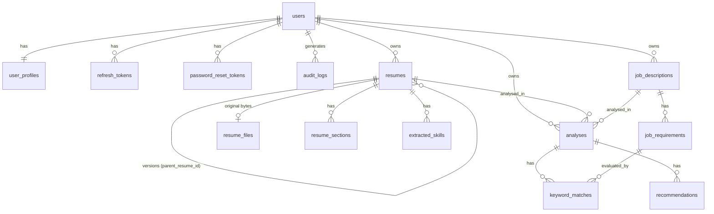

# Database schema

PostgreSQL in production (Neon), SQLite for local development and fast tests. All primary keys are UUIDs; all tables have `created_at`/`updated_at` (UTC). Every user-owned table has a `user_id` (directly or through its parent) and every query is filtered by it. Deleting a user cascades to everything they own.

| Table | Purpose / notable columns |
|---|---|
| `users` | `email` (unique, lower-cased), `password_hash` (Argon2id), `is_active` |
| `user_profiles` | `full_name`, `headline`, `retention_days`, `store_original_files` |
| `refresh_tokens` | `token_hash` (SHA-256, the raw token is never stored), `family_id`, `expires_at`, `revoked_at`, `replaced_by_id` — enables rotation and reuse detection |
| `password_reset_tokens` | `token_hash`, `expires_at` (1 h), `used_at` |
| `audit_logs` | `action`, `resource_type/id`, `ip_hash`, `email_hash` (keyed hashes, never raw), `metadata`, used for rate limiting and the activity feed |
| `resumes` | `name`, `version`, `parent_resume_id`, `status`, `extraction_method`, `extraction_confidence`, `word_count`, `parsed_data` (JSON), `warnings` (JSON), `has_original_file` |
| `resume_files` | original bytes (`BYTEA`), one row per resume; separate table keeps list queries light |
| `resume_sections` | `section_type`, `heading_text`, `content`, `order_index`, `confidence`, `user_edited` |
| `extracted_skills` | `canonical_name`, `category`, `evidence_level`, `occurrences`, `context_snippet` |
| `job_descriptions` | `title`, `company`, `location`, `raw_text`, `source_type` (`paste`/`url`), `source_url` |
| `job_requirements` | `kind`, `canonical_name`, `importance`, `min_years`, `evidence_snippet` |
| `analyses` | `overall_score`, `engine_version`, JSON: `dimension_scores`, `scoring_config`, `metrics`, `keyword_counts`, `skills_comparison`, `section_analysis`. Snapshot columns `resume_name`/`job_title`/`company` keep history readable |
| `keyword_matches` | per requirement: `original_keyword`, `normalized_keyword`, `match_type`, `result_category`, `similarity`, `confidence`, `credit`, `occurrences`, `source_section`, `suggested_section`, `explanation` |
| `recommendations` | `section_type`, `priority`, `kind`, `title`, `detail`, `caveat`, `example_template`, `is_suggestion` |

Indexes cover the foreign keys plus `(user_id, created_at)` on resumes/jobs/analyses and `(action, ip_hash, created_at)` on audit logs (rate limiting).

## Migrations

Alembic lives in `backend/migrations`. The baseline revision `0001` creates the schema from the models; future changes are added as new revisions (`alembic revision --autogenerate -m "..."`). The backend CI job runs `alembic upgrade head` against an empty Postgres to prove migrations apply.

The Neon/Vercel setup needs the pooled connection string; the engine uses `NullPool` on Vercel and disables server-side prepared statements so PgBouncer works.
